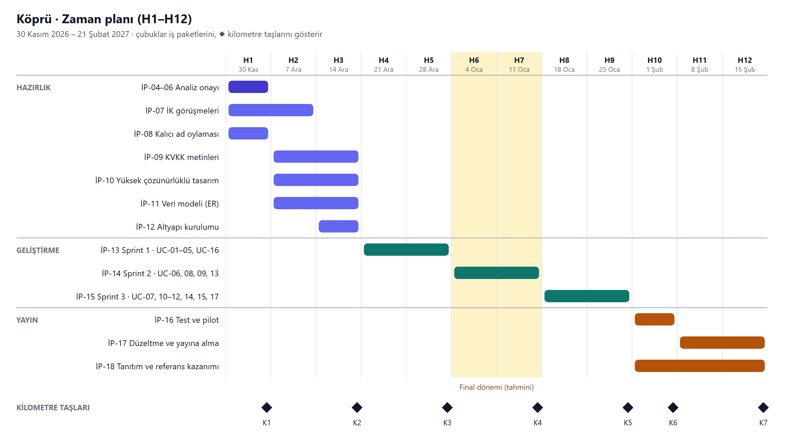

# Zaman Planı (v1.0)

> Başlangıç: **30 Kasım 2026** (H1). Bitiş: **21 Şubat 2027** (H12). Gantt şeması: [`diyagramlar/svg/zaman-plani.svg`](../diyagramlar/svg/zaman-plani.svg).
> Final sınavı dönemi tahmini olarak H6–H7'ye (4–17 Ocak) yerleştirildi. Kesin tarihler gelince plan kaydırılır.

## 1. Haftalar

| Hafta | Tarih | Aşama |
|---|---|---|
| H1 | 30 Kas – 6 Ara | Analiz onayı, ad oylaması, İK görüşmeleri |
| H2 | 7 – 13 Ara | Tasarım, veri modeli, KVKK metinleri |
| H3 | 14 – 20 Ara | Tasarım, veri modeli, altyapı kurulumu |
| H4 | 21 – 27 Ara | Sprint 1 |
| H5 | 28 Ara – 3 Oca | Sprint 1 (yılbaşı haftası) |
| H6 | 4 – 10 Oca | Sprint 2 (final dönemi, hafif yük) |
| H7 | 11 – 17 Oca | Sprint 2 (final dönemi, hafif yük) |
| H8 | 18 – 24 Oca | Sprint 3 (yarıyıl tatili) |
| H9 | 25 – 31 Oca | Sprint 3 (yarıyıl tatili) |
| H10 | 1 – 7 Şub | Test ve pilot |
| H11 | 8 – 14 Şub | Düzeltmeler |
| H12 | 15 – 21 Şub | Yayına alma ve tanıtım |

## 2. Use case / gereksinim → sprint eşlemesi

| Sprint | Hafta | Use case | Gereksinimler | Kilometre taşı |
|---|---|---|---|---|
| Hazırlık | H1–H3 | — | NFR-01, NFR-02, NFR-12 | Analiz onaylandı, altyapı hazır |
| Sprint 1 | H4–H5 | UC-01, UC-02, UC-03, UC-04, UC-05, UC-16 | FR-01–FR-06, FR-17, NFR-01, NFR-05, NFR-06 | Bir referans davet edilip aktifleşebiliyor |
| Sprint 2 | H6–H7 | UC-06, UC-08, UC-09, UC-13 | FR-07, FR-08, FR-10, FR-11, FR-14, NFR-04, NFR-07, NFR-10 | Talep oluşturulup doğru referansa ulaşıyor |
| Sprint 3 | H8–H9 | UC-07, UC-10, UC-11, UC-12, UC-14, UC-15, UC-17 | FR-09, FR-12, FR-13, FR-15, FR-16, NFR-03 | Uçtan uca akış ve KVKK hakları çalışıyor |
| Test ve pilot | H10 | Tümü | NFR-08, NFR-09, NFR-12 | Grup içi 20–30 kişilik pilot |
| Yayın | H11–H12 | Tümü | NFR-11, NFR-13 | Canlı ortam ve tanıtım |

## 3. Kilometre taşları

| # | Tarih | Kilometre taşı |
|---|---|---|
| K1 | 6 Ara 2026 | Analiz ve tasarım hocalarımızca onaylandı |
| K2 | 20 Ara 2026 | Veri modeli, KVKK metinleri ve altyapı hazır |
| K3 | 3 Oca 2027 | Sprint 1 demosu: davet → rıza → aktif referans |
| K4 | 17 Oca 2027 | Sprint 2 demosu: talep → eşleştirme → bildirim |
| K5 | 31 Oca 2027 | Sprint 3 demosu: uçtan uca akış |
| K6 | 7 Şub 2027 | Pilot tamamlandı, geri bildirimler toplandı |
| K7 | 21 Şub 2027 | Yayın |

## 4. Riskler

| Risk | Etki | Önlem |
|---|---|---|
| Final dönemi geliştirmeyi yavaşlatır | Sprint 2 gecikir | Sprint 2 kapsamı küçük tutuldu; tatil haftaları Sprint 3'e verildi. |
| Yeterli referans katılmaz | Eşleştirme sonuç vermez | Pilot eşiği 3 onaylı referans; tanıtım İP-18 erken başlar. |
| SMS için kurum hesabı bulunamaz | Telefon doğrulaması zayıf kalır | v1 e-posta + iş e-postası rozeti ile çıkar; SMS v2'ye kalır. |
| Gönüllü katılımı düşer | İş paketleri boş kalır | Küçük issue'lar, `ilk katkı` etiketi, haftalık durum notu. |
