

Analiz ve Tasarım Raporu · v1.0

<h1 class="kapak-baslik">Köprü</h1>

Referansla iş bulmayı kolaylaştıran, gönüllülük esaslı bir dayanışma ağı

<table class="kapak-tablo">
<tr><td>Tarih</td><td>28 Kasım 2026</td></tr>
<tr><td>Hazırlayan</td><td>Iliya Dindar</td></tr>
<tr><td>GitHub</td><td>github.com/iliyadindar</td></tr>
</table>

"Köprü" çalışma adıdır; kalıcı ad ekip oylamasıyla belirlenecektir.

<h2>İçindekiler</h2>
<ol>
<li>Gereksinim analizi</li>
<li>Use case şemaları ve senaryolar</li>
<li>Arayüz taslakları</li>
<li>Görev dağılımı</li>
<li>Use case / gereksinim zaman planlaması</li>
</ol>

!include ../analiz/gereksinimler.md

# Use Case Şemaları

Sistem dört diyagramla gösterilmiştir: genel bakış ve üç ayrıntılı görünüm. Diyagramlar `diyagramlar/uretici.py` betiğiyle koddan üretilir.

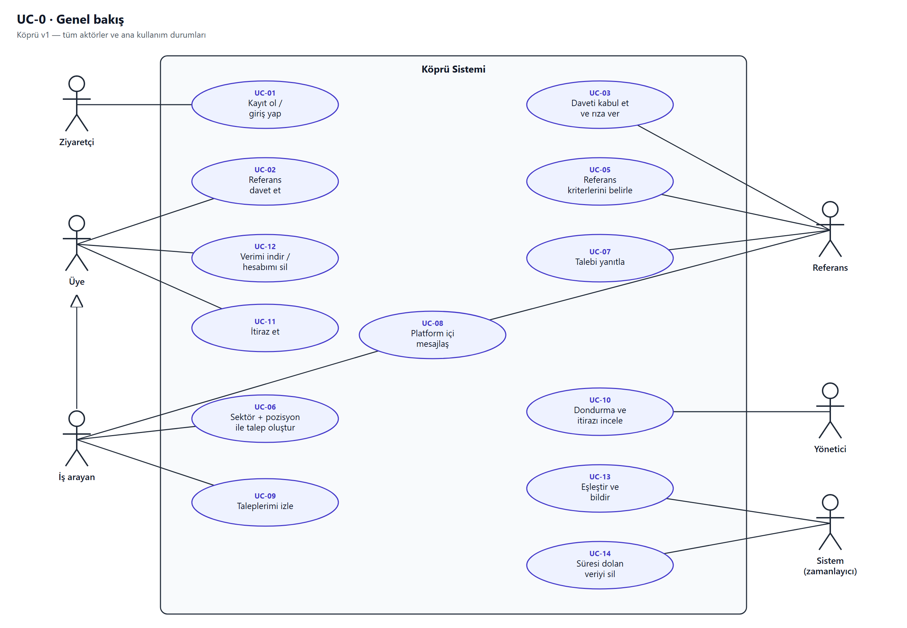

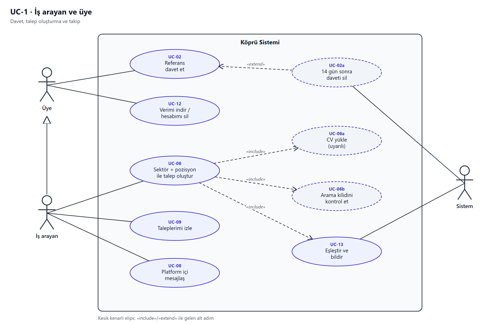

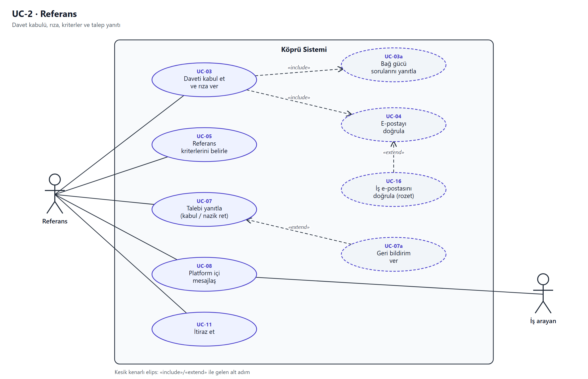

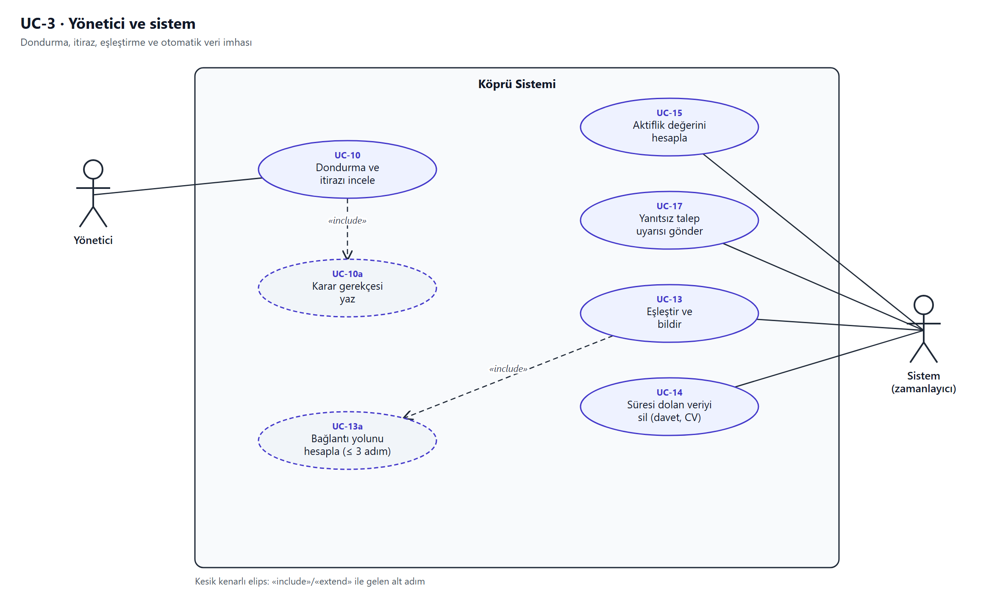

!include ../analiz/use-case-senaryolari.md

# Arayüz Taslakları

Düşük çözünürlüklü, gri tonlu taslaklardır; renk ve görseller bilerek yer tutucu bırakılmıştır. Tüm kişi ve şirket adları uydurmadır. Mobil öncelikli tasarlanmış, ana ekranların masaüstü görünümü de çizilmiştir.

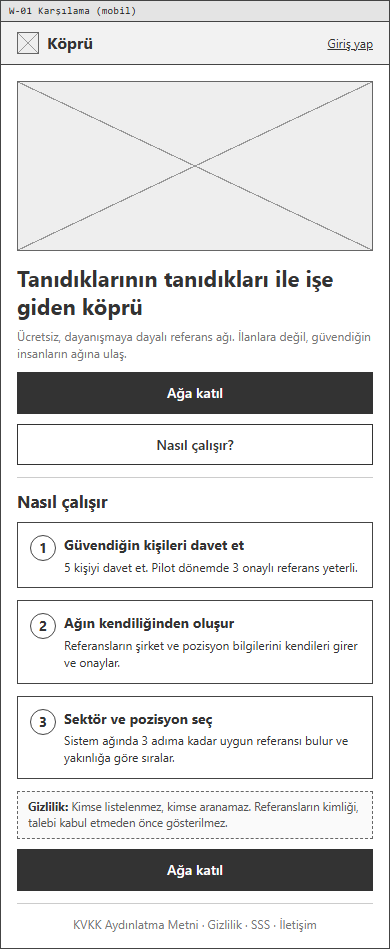

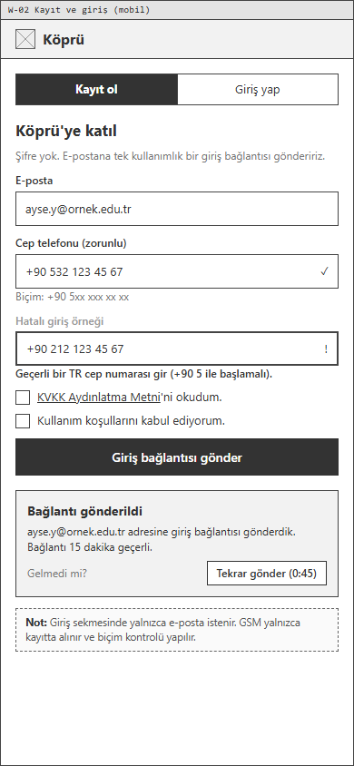

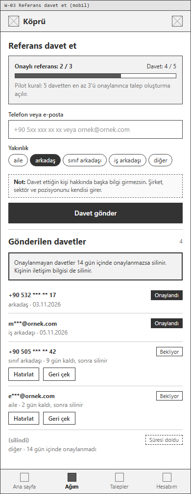

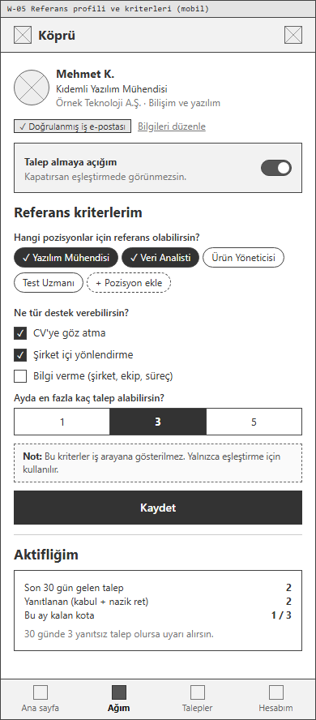

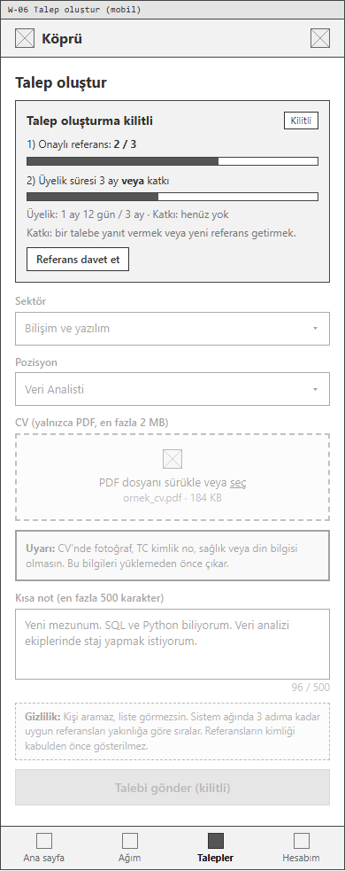

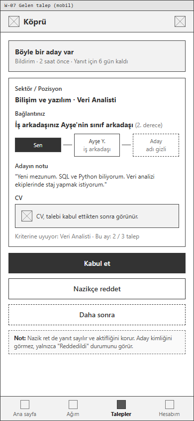

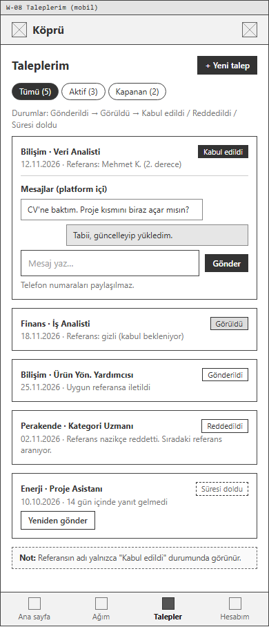

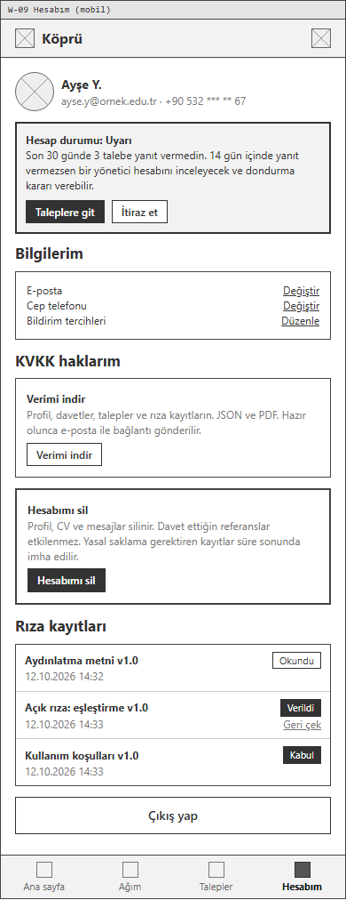

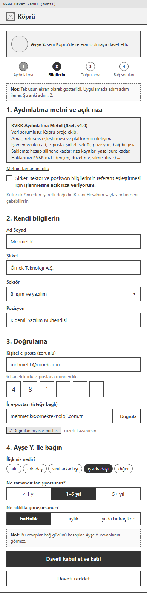

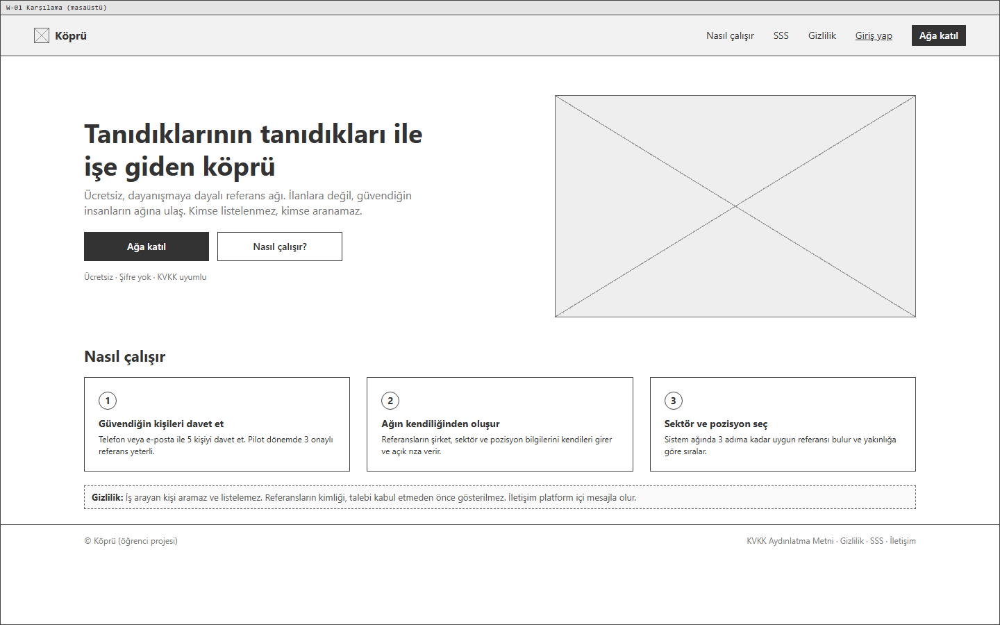

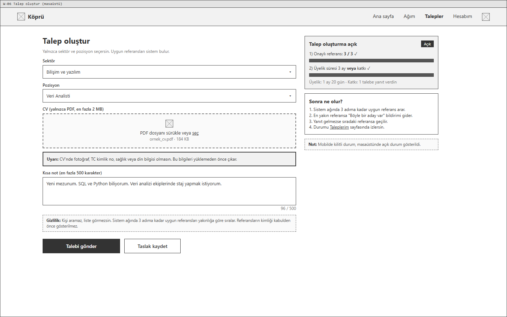

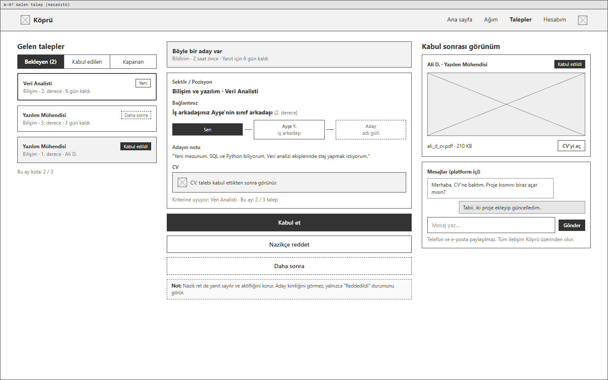

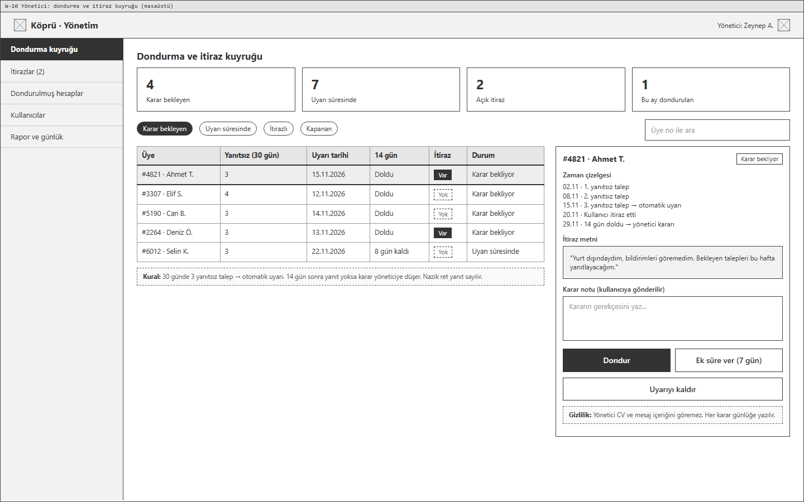

!include ../analiz/gorev-dagilimi.md

!include ../analiz/zaman-plani.md

